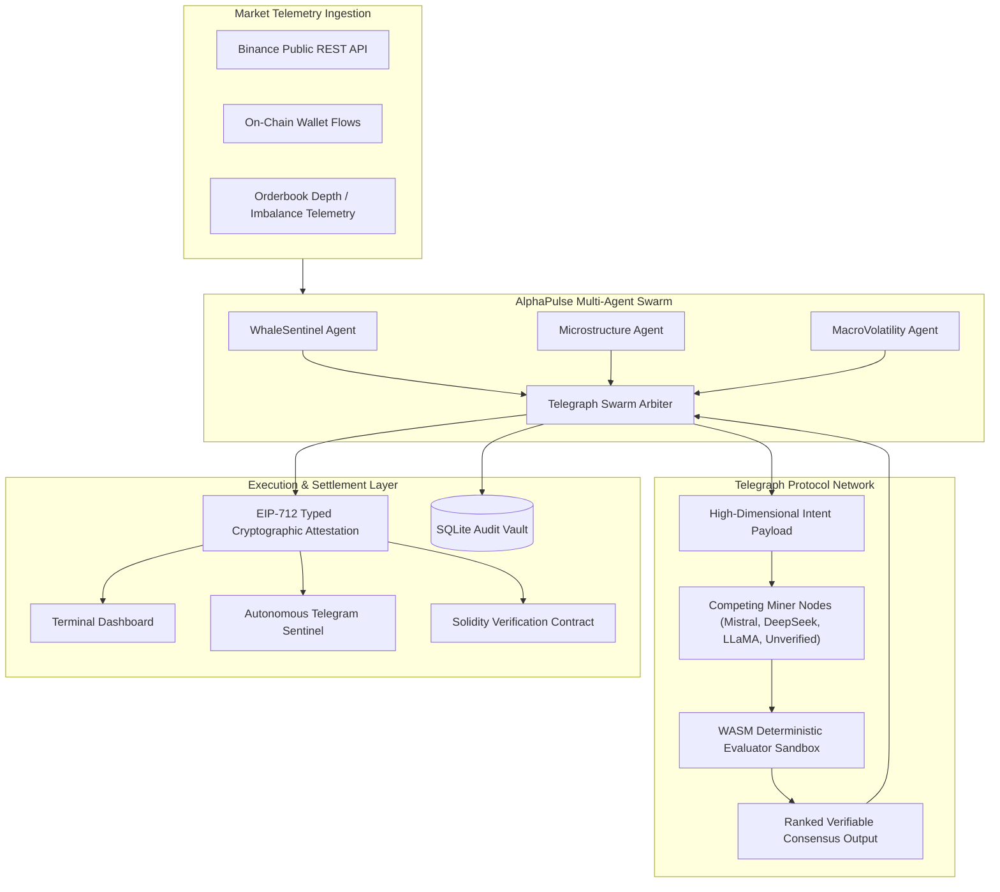

# AlphaPulse Swarm

> Autonomous Verifiable Financial Intelligence Agent for Telegraph Protocol Season II  
> Architecture: Multi-Agent Swarm · WASM Evaluator Arbitration · EIP-712 On-Chain Attestation

[](https://www.python.org/)
[](https://opensource.org/licenses/MIT)
[](https://telegraphprotocol.com)
[](https://eips.ethereum.org/EIPS/eip-712)

AlphaPulse Swarm is an autonomous financial risk sentinel and alpha generation engine built for the **Telegraph Protocol Season II Hackathon** (Track: **Apps & Agents**).

In high-stakes financial and decentralized finance (DeFi) environments, relying on unverified single-model LLM predictions or raw unverified API feeds introduces significant systemic risk due to hallucinations, orderbook manipulation, wash trading, and liquidity spoofing. AlphaPulse addresses this vulnerability by coordinating a **specialized multi-agent swarm**, formatting high-dimensional financial intents for **Telegraph's decentralized intelligence marketplace**, and executing trades strictly when competing miners achieve verifiable consensus scored by deterministic **WASM evaluators**, cryptographically attested through **EIP-712 structured data signatures**.

---

## Core Capabilities

- **Multi-Agent Swarm Architecture:** Executes three concurrent specialized sub-agents (`WhaleSentinel`, `MicrostructureAgent`, `MacroVolatilityAgent`) coordinated by an arbitration layer (`TelegraphSwarmArbiter`).
- **Deterministic WASM Validation:** Interrogates Telegraph's WebAssembly evaluation sandbox to penalize hallucinated or manipulated miner proposals (applying up to 95% penalty slashes during spoofing attacks).
- **Quantitative Simulation Engine:** Includes a 60-period empirical backtesting framework comparing unverified LLM baselines against Telegraph-validated consensus, evaluating Sharpe ratios, Sortino ratios, and maximum drawdown.
- **EIP-712 Cryptographic Attestation:** Every arbitrated trade recommendation is signed as an EIP-712 typed structured data hash, verifiable on-chain via EVM smart contracts.
- **Live Market Telemetry:** Connects directly to Binance public REST endpoints for real-time 24-hour spot prices and historical 1-hour candlestick feeds, with automated fallback logic.
- **Autonomous Telegram Sentinel:** Long-polling notification daemon supporting interactive mobile audits (`/audit`, `/simulate`, `/backtest`, `/status`).
- **Persistent Telemetry Vault:** Thread-safe SQLite database recording audit histories, miner latencies, scores, and historical win-rate rankings.

---

## System Architecture



---

## Repository Structure

```
telegraph-alpha-agent/
├── core/
│   ├── models.py             # Pydantic schemas for Intents, Miners, Evaluators, and Reports
│   ├── market_data.py        # Live Binance market data and stress simulation scenarios
│   ├── telegraph_client.py   # Dual-mode Telegraph Protocol client (MOCK simulation & LIVE Season II)
│   ├── agent.py              # Autonomous Alpha synthesis engine
│   ├── swarm.py              # Multi-Agent Swarm (Whale, Micro, Macro) and Arbiter
│   ├── backtest.py           # Quantitative backtesting simulation engine and metrics
│   ├── crypto_attestation.py # EIP-712 typed data signing and Solidity verification contract
│   └── database.py           # Persistent SQLite audit telemetry and miner leaderboard
├── dashboard/
│   └── app.py                # Streamlit quantitative terminal interface
├── tests/
│   └── test_agent.py         # Test suite covering Swarm, crypto, and backtest logic
├── sentinel_bot.py           # Autonomous Telegram Sentinel daemon
├── main.py                   # Terminal CLI runner
├── requirements.txt          # Python dependencies
├── .env.example              # Environment variables template
└── README.md
```

---

## Installation & Quick Start

### 1. Environment Setup

```bash
git clone https://github.com/rodrigoocbz/telegraph-alphapulse.git
cd telegraph-alphapulse
python3 -m venv .venv
source .venv/bin/activate
pip install -r requirements.txt
```

### 2. Run Test Suite

```bash
python tests/test_agent.py
```

### 3. Launch the Terminal Dashboard

```bash
streamlit run dashboard/app.py
```

The interface will be accessible at `http://localhost:8501`, featuring:
- **Market Telemetry:** Real-time Binance candlestick series and dynamic target bounds.
- **Swarm Reasoning:** Independent telemetry contributions from concurrent sub-agents.
- **WASM Evaluators:** Multi-miner accuracy, consistency, latency, and penalty rankings.
- **Quantitative Benchmark:** Historical capital growth curves and risk-adjusted metrics.
- **EIP-712 Attestation:** Structured data JSON payload and Solidity smart contract verifier.
- **Audit Ledger:** Historical transaction records and miner win-rate metrics.

### 4. Run the Telegram Sentinel Bot

```bash
python sentinel_bot.py
```

Supported commands:
- `/audit BTC` - Execute live Swarm and Telegraph evaluation on Bitcoin.
- `/simulate spoofing` - Inject synthetic orderbook spoofing to verify evaluator defense.
- `/backtest` - Retrieve 60-period quantitative benchmark summary.
- `/status` - Check daemon and protocol connectivity.

---

## On-Chain Verification (Solidity)

AlphaPulse outputs standard **EIP-712 typed signatures** verifiable on Ethereum, Arbitrum, or Base:

```solidity
bytes32 digest = _hashTypedDataV4(keccak256(abi.encode(
    REPORT_TYPEHASH,
    keccak256(bytes(reportId)),
    keccak256(bytes(asset)),
    keccak256(bytes(action)),
    currentPriceUsd,
    confidenceBps,
    keccak256(bytes(winningMiner)),
    timestamp,
    keccak256(bytes(proofHash))
)));
address recoveredSigner = ECDSA.recover(digest, signature);
require(recoveredSigner == telegraphAttestor, "INVALID_TELEGRAPH_SIGNATURE");
```

---

## License

This project is licensed under the MIT License. Developed for the Telegraph Protocol Season II Hackathon.
